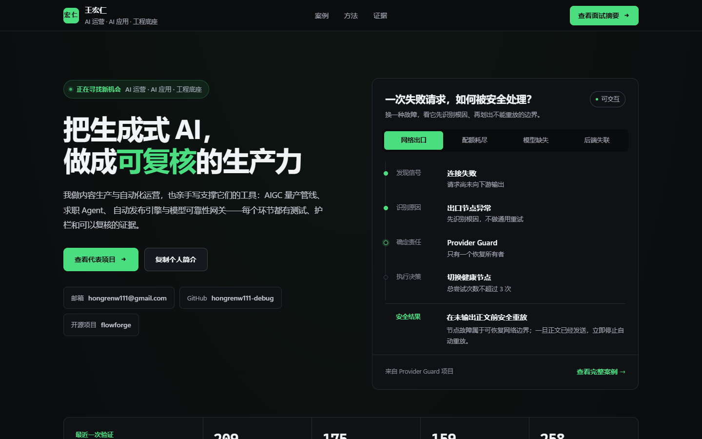

# 王宏仁 · 证据型作品集

面向 **AI 运营、AI 应用**岗位的证据型中文作品集，同时保留 AI 平台与可靠性工程方向的完整档案。

它不是项目截图组成的模板页，而是一组工程档案：每个案例都明确记录约束、关键决策、运行机制、验证证据和仍未完成的公开化工作。



## 当前交付

- 近黑底、单一绿色强调的工程档案式单页作品集：大字标题、细线分区、可交互的故障处置轨迹
- 可切换网络、配额、模型与后端故障的 Failure Atlas
- 八个案例的可访问详情对话框（AI 运营向：FlowForge / 小红书内容引擎 / Job Apply Agent / AIGC 量产管线；工程向：Provider Guard / ego-win / cs2-arb / RyzaChat）
- Provider Guard 验证快照
- Capability × Evidence 能力矩阵
- 已完成 / 正在作品集化 / 公开边界证据账本
- 可复制的面试摘要与简历要点
- 首屏、结尾与页脚都可直接下载 PDF 简历
- Open Graph 分享卡（1200×630）与 canonical，粘贴到聊天工具时有预览
- 零第三方运行依赖的静态服务器
- 内容、敏感信息和基本可访问性自动检查

## 本地运行

需要 Node.js 20 或更高版本。

```powershell
npm run dev
```

然后访问：

```text
http://127.0.0.1:4173
```

使用其他端口：

```powershell
$env:PORT = "4300"
npm run dev
```

## 质量检查

```powershell
npm run check
```

检查内容包括：

- 八个项目的数据完整性与唯一 slug
- 每个案例是否都有对应的 `docs/case-studies/<slug>.md` 深度文档
- HTML 本地资源是否存在
- 公开资源中是否出现本地绝对路径、疑似密钥、Cookie 或占位文案
- CS2 项目是否明确保持模拟语义
- 键盘跳转、对话框标签、reduced-motion 和移动端样式是否存在

## 内容事实源

| 项目 | 当前依据 | 公开状态 |
|---|---|---|
| FlowForge AI 导演 | GitHub 开源仓库、GitHub Actions CI 209 测试通过（最后成功运行 2026-09-01） | 公开开源；仓库近期无提交 |
| 小红书内容引擎 | 当前源码、175 测试全绿、0-LLM 合规闸门与真实指标采集链路 | 流水线就绪；半自动发布，采集样本 6 篇 |
| Job Apply Agent | 当前源码、ADR、2026-10-22 node --test 159/159 实测（09-14 为 107/107） | 本地运行；真机选择器校准与小批次试水中 |
| ego-win | 上游 SDK 逐字节 vendored、63/63 单测、上游套件 68/69 | 本地运行；仓库待公开 |
| AIGC 量产管线 | 当前工作流配置、产出资产与一致性方案记录 | 个人工作流日用；对比展示待补 |
| Provider Guard / AgentGate | 当前源码、维护合同、2026-08-30 只读运行验证 | 本地运行；通用公开版本待重构 |
| cs2-arb | 当前源码、258 项离线测试全绿（2026-10-22）、三份 ADR | 决策辅助；不做自动交易 |
| RyzaChat:AI | 当前源码图谱、资产清单（298 骨骼/74 音轨/OBS 独立皮套） | 本地运行；安全加固和公开素材替换中 |

详细边界见 [`docs/EVIDENCE_REGISTER.md`](docs/EVIDENCE_REGISTER.md)。

## 目录

```text
career-portfolio/
├─ index.html
├─ styles.css
├─ app.js
├─ archive/
│  ├─ visual-v1-2026-08-30/
│  ├─ visual-v2-blueprint-2026-08-30/
│  └─ visual-v3-industrial-2026-09-06/
├─ data/
│  └─ portfolio.json
├─ docs/
│  ├─ EVIDENCE_REGISTER.md
│  ├─ PORTFOLIO_ROADMAP.md
│  ├─ RESUME_BULLETS.md
│  └─ case-studies/
├─ scripts/
│  ├─ serve.mjs
│  └─ validate.mjs
└─ tests/
   └─ portfolio.test.mjs
```

## 设计原则

1. **专业而不模板化**：近黑底、单色绿强调、等宽数字与大面积留白；层级靠字号、间距和明度建立，不靠彩色标签、英文大写眉标或装饰性编号。
2. **一次醒目表达**：把视觉重点集中在可交互的故障处置轨迹，其余区域保持安静；一个区域只有一个主角。
3. **事实优先**：运行事实和规划功能分开呈现。
4. **故障优先**：项目文案重点说明失败分类、恢复路径和不可重放边界。
5. **不伪装生产**：本地运行不写成线上生产，已有测试文件不写成当前测试全部通过。
6. **不暴露隐私**：公开资源不包含账号、Cookie、API key、聊天历史、真实节点或本地绝对路径。
7. **无框架依赖**：使用原生 HTML/CSS/JavaScript，减少部署摩擦；可直接托管到任意静态站点。

历史视觉版已完整保存：

- [`archive/visual-v1-2026-08-30`](archive/visual-v1-2026-08-30/)：初始编辑式方案
- [`archive/visual-v2-blueprint-2026-08-30`](archive/visual-v2-blueprint-2026-08-30/)：蓝图技术方案
- [`archive/visual-v3-industrial-2026-09-06`](archive/visual-v3-industrial-2026-09-06/)：工业诊断仪器方案

## 下一阶段

1. 将 AgentGate 抽成独立、脱敏、可公开仓库。
2. 为核心项目各录制 60–90 秒演示。
3. 增加三篇 Engineering Notes：Provider 故障恢复、Token 语义压缩、合规纯函数闸门。
4. 统一执行并记录 CS2 项目的 `pnpm check` 与 Playwright E2E 结果。
