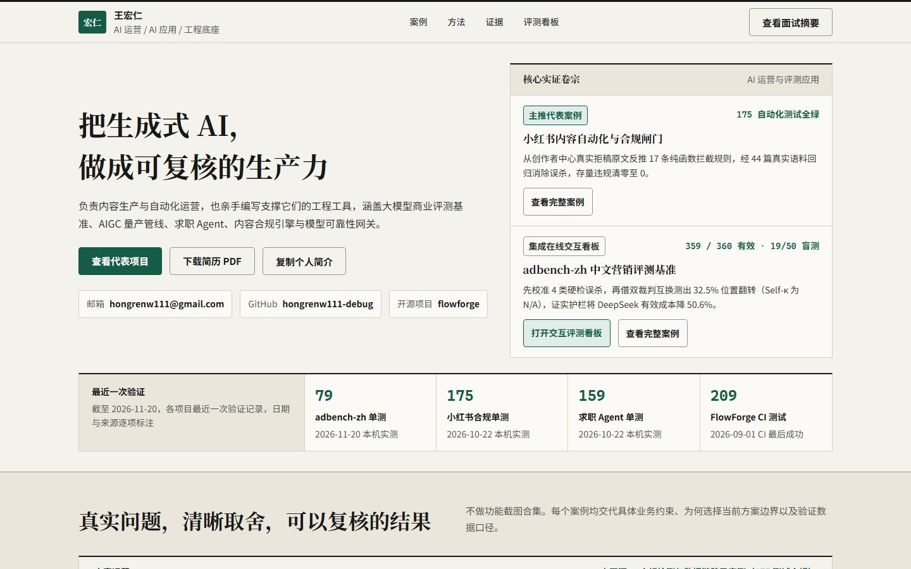

# 王宏仁 · 证据型作品集

面向 **AI 运营、AI 应用**岗位的证据型中文作品集，同时保留 AI 平台与可靠性工程方向的完整档案。

它不是项目截图组成的模板页，而是一组工程档案：每个案例都明确记录约束、关键决策、运行机制、验证证据和仍未完成的公开化工作。



## 当前交付

- 暖矿石纸底（`#f4f2ec`）+ 单一深松绿（`#145c46`）出版物档案风单页作品集：衬线标题、细线分区、核心实证卷宗与可交互的故障处置轨迹
- 集成 `adbench-zh` 纯静态评测看板（`./adbench-zh/`），内置交互排行榜、帕累托象限、护栏 ROI 对比、尺子校准数据与 14 例真实 Bad Case 浏览器
- 可切换网络、配额、模型与后端故障的 Failure Atlas（明确「响应头或首个响应字节发出后禁止重放」边界）
- 九个案例的可访问详情对话框（AI 运营与评测向：`adbench-zh` / 小红书内容引擎 / FlowForge / Job Apply Agent / AIGC 量产管线；工程与多媒体向：Provider Guard / ego-win / cs2-arb / RyzaChat:AI）
- 截至 `2026-11-20` 的实测验证快照（逐项标明测试日期与来源）
- Capability × Evidence 能力矩阵
- 已验证 / 正在作品集化 / 公开边界证据账本
- 可复制的面试摘要与个人简介
- 首屏、结尾与页脚均可下载 PDF 简历（2 页，`2026-11-20` 版，与页面 9 个项目口径一致）
- Open Graph 分享卡（1200×630）、深松绿「宏」字印章 Favicon 与 canonical 元数据
- 零第三方运行依赖的静态服务器（兼容 `/adbench-zh/` 目录访问与路径穿越防御）
- 内容完整性、敏感信息与可访问性自动检查

## 本地运行

需要 Node.js 20 或更高版本。

```powershell
npm run dev
```

然后访问：

```text
http://127.0.0.1:4173
```

使用其他端口：

```powershell
$env:PORT = "4300"
npm run dev
```

## 质量检查

```powershell
npm run check
npm run build
```

检查内容包括：

- 九个项目的数据完整性与唯一 slug，以及 `./adbench-zh/` 等本地看板入口存在性
- 每个案例是否都有对应的 `docs/case-studies/<slug>.md` 深度文档
- HTML 本地资源是否存在
- 公开资源中是否出现本地绝对路径、疑似密钥、Cookie 或占位文案
- CS2 项目是否明确保持模拟语义、`adbench-zh` 是否保留 19/50 与 `N/A` 诚实边界
- 键盘跳转、对话框标签、`reduced-motion` 和移动端样式是否存在

## 简历 PDF

`assets/wang-hongren-resume.pdf`（2 页）由 [`docs/resume-source.html`](docs/resume-source.html) 渲染，改完 HTML 后在仓库根目录运行：

```powershell
$htmlUri = ([System.Uri](Resolve-Path 'docs\resume-source.html').Path).AbsoluteUri
& "C:\Program Files\Google\Chrome\Application\chrome.exe" --headless=new --disable-gpu `
  --no-pdf-header-footer --print-to-pdf="assets\wang-hongren-resume.pdf" $htmlUri
```

数字口径必须与 `data/portfolio.json` 保持一致；页面与简历的测试数字都标注实测日期。

## 内容事实源

| 项目 | 当前依据 | 公开状态 |
|---|---|---|
| adbench-zh评测基准 | 30 条对抗 Brief、359/360 真实采样、L1 v2 校准、L2 40 对位置互换、19/50 盲测、79 单测全绿（2026-11-20） | 未开源（仓库待整理公开）；交互看板已集成于 `./adbench-zh/` |
| 小红书内容引擎 | 当前源码、175 测试全绿（2026-10-22）、17 条 0-LLM 合规闸门与平铺 DOM 采集链路 | 未开源；流水线就绪，半自动人工确认发布，采集样本 6 篇 |
| FlowForge AI 导演 | GitHub 公开开源仓库、GitHub Actions CI 209 测试通过（最后成功运行 2026-09-01） | 公开开源（MIT）；仓库自 2026-09-01 后无提交 |
| Job Apply Agent | 当前源码、4 份 ADR、2026-10-22 `node --test` 159/159 实测（09-14 为 107/107） | 本地运行 · 未开源；真机选择器校准中 |
| ego-win | 上游 SDK 逐字节 vendored、63/63 单测、上游套件 68/69 | 本地运行 · 未开源（仓库待公开） |
| AIGC 量产管线 | 当前工作流配置、产出资产与一致性方案记录 | 个人工作流 · 未开源；日用交付中 |
| Provider Guard / AgentGate | 当前源码、2026-08-30 只读运行验证（8+8 节点池、响应头/首字节不可重放边界） | 本地运行 · 未开源（通用公开版本重构准备） |
| cs2-arb | 当前源码、258 项离线测试全绿（2026-10-22）、3 份 ADR | 决策辅助 · 未开源；不做自动交易 |
| RyzaChat:AI | 当前源码图谱（63 函数/34 场景）、资产清单（74 音轨/298 骨骼） | 本地原型 · 不计划开源（有已知未修项） |

详细边界见 [`docs/EVIDENCE_REGISTER.md`](docs/EVIDENCE_REGISTER.md)。

## 目录

```text
career-portfolio/
├─ index.html
├─ styles.css
├─ app.js
├─ PRODUCT.md
├─ adbench-zh/
│  ├─ index.html
│  ├─ styles.css
│  ├─ app.js
│  └─ data/benchmark-snapshot.json
├─ assets/
│  ├─ favicon.svg
│  ├─ og-cover.png
│  └─ wang-hongren-resume.pdf
├─ archive/
│  ├─ visual-v1-2026-08-30/
│  ├─ visual-v2-blueprint-2026-08-30/
│  └─ visual-v3-industrial-2026-09-06/
├─ data/
│  └─ portfolio.json
├─ docs/
│  ├─ EVIDENCE_REGISTER.md
│  ├─ PORTFOLIO_ROADMAP.md
│  ├─ RESUME_BULLETS.md
│  ├─ resume-source.html
│  └─ case-studies/
├─ scripts/
│  ├─ build.mjs
│  ├─ serve.mjs
│  └─ validate.mjs
└─ tests/
   └─ portfolio.test.mjs
```

## 设计原则

1. **出版物档案质感**：暖矿石纸底（`#f4f2ec`）、亚麻卡片底（`#eae6db`）、单一深松绿强调（`#145c46`）、等宽数字与清晰留白；用边框、字重和版面节奏建立阅读秩序。
2. **一屏一个主角**：首屏聚焦主旨与右侧双焦点实证卷宗，方法区聚焦可交互的 Failure Atlas，其余区域保持信息克制。
3. **事实优先**：已实测事实、样本量局限与规划中能力分开呈现，不掩盖 `N/A` 与未验证边界。
4. **故障优先**：项目文案重点说明失败分类、恢复路径和不可重放边界。
5. **不伪装生产**：本地运行与未开源项目明示状态，历史 CI 记录标明具体日期。
6. **不暴露隐私**：公开资源不包含账号、Cookie、API key、网关路由前缀、真实节点或本地绝对路径。
7. **无框架依赖**：原生 HTML/CSS/JavaScript 构建，打包输出 `dist/`，兼容 GitHub Pages 零构建运行或直接托管。

历史视觉版已保存在归档目录：

- [`archive/visual-v1-2026-08-30`](archive/visual-v1-2026-08-30/)：初始编辑式方案
- [`archive/visual-v2-blueprint-2026-08-30`](archive/visual-v2-blueprint-2026-08-30/)：蓝图技术方案
- [`archive/visual-v3-industrial-2026-09-06`](archive/visual-v3-industrial-2026-09-06/)：工业诊断仪器方案

## 下一阶段

1. 将 `AgentGate` 与 `adbench-zh` 脱敏整理为独立可公开 Git 仓库。
2. 扩充 `adbench-zh` 商业 Brief 至百条级，并完成完整 50 题双盲标注以测出有效 Self-Kappa。
3. 真机校准 `Job Apply Agent` 三平台选择器并完成小批次验证。
4. 为核心项目各录制 60–90 秒端到端演示并补充合规纯函数闸门、Provider 故障恢复工程笔记。
