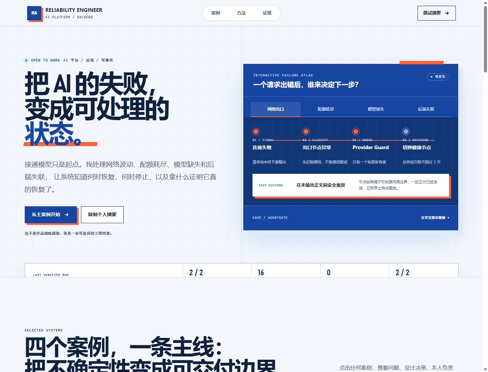

# RA / Reliability Portfolio

面向 **AI Platform、Backend、Reliability/SRE** 岗位的证据型中文作品集。

它不是四张项目截图组成的模板页，而是一组工程档案：每个案例都明确记录约束、关键决策、运行机制、验证证据和仍未完成的公开化工作。



## 当前交付

- 蓝图式响应式单页作品集主页
- 可切换网络、配额、模型与后端故障的 Failure Atlas
- 四个项目的可访问详情对话框
- Provider Guard 验证快照
- Capability × Evidence 能力矩阵
- 已完成 / 正在作品集化 / 公开边界证据账本
- 可复制的面试摘要与简历要点
- 零第三方运行依赖的静态服务器
- 内容、敏感信息和基本可访问性自动检查

## 本地运行

需要 Node.js 20 或更高版本。

```powershell
cd "C:\Users\Ra\Documents\ChatGPT\反代\career-portfolio"
npm run dev
```

然后访问：

```text
http://127.0.0.1:4173
```

使用其他端口：

```powershell
$env:PORT = "4300"
npm run dev
```

## 质量检查

```powershell
npm run check
```

检查内容包括：

- 四个项目的数据完整性与唯一 slug
- HTML 本地资源是否存在
- 公开资源中是否出现本地绝对路径、疑似密钥、Cookie 或占位文案
- CS2 项目是否明确保持模拟语义
- 键盘跳转、对话框标签、reduced-motion 和移动端样式是否存在

## 内容事实源

| 项目 | 当前依据 | 公开状态 |
|---|---|---|
| Provider Guard / AgentGate | 当前源码、维护合同、2026-08-30 只读运行验证 | 本地运行；通用公开版本待重构 |
| Local AI Media Pipeline | 已沉淀的 MiniMax H3 / ComfyUI 本地配置与 Runner | 本地验证；性能证据待匿名化 |
| Agent Skill Router | 跨 Agent 共享记忆、意图矩阵和本地角色调度配置 | 工作流运行；演示轨迹待补 |
| CS2 Simulator | 当前代码图谱和只读源码审计 | 模拟模式；公开仓库待清理和新鲜测试 |

详细边界见 [`docs/EVIDENCE_REGISTER.md`](docs/EVIDENCE_REGISTER.md)。

## 目录

```text
career-portfolio/
├─ index.html
├─ styles.css
├─ app.js
├─ archive/
│  └─ visual-v1-2026-08-30/
├─ data/
│  └─ portfolio.json
├─ docs/
│  ├─ EVIDENCE_REGISTER.md
│  ├─ PORTFOLIO_ROADMAP.md
│  ├─ RESUME_BULLETS.md
│  └─ case-studies/
├─ scripts/
│  ├─ serve.mjs
│  └─ validate.mjs
└─ tests/
   └─ portfolio.test.mjs
```

## 设计原则

1. **视觉来自主题**：把可靠性工程里的故障路径、恢复所有权和验证节点变成页面结构，而不是套作品集模板。
2. **一次醒目表达**：把视觉重点集中在可交互的 Failure Atlas，其余区域保持清晰、克制。
3. **事实优先**：运行事实和规划功能分开呈现。
4. **故障优先**：项目文案重点说明失败分类、恢复路径和不可重放边界。
5. **不伪装生产**：本地运行不写成线上生产，已有测试文件不写成当前测试全部通过。
6. **不暴露隐私**：公开资源不包含账号、Cookie、API key、聊天历史、真实节点或本地绝对路径。
7. **无框架依赖**：使用原生 HTML/CSS/JavaScript，减少部署摩擦；可直接托管到任意静态站点。

旧视觉版已完整保存在 [`archive/visual-v1-2026-08-30`](archive/visual-v1-2026-08-30/)，便于比较与回退。

## 下一阶段

1. 补充真实姓名、公开邮箱、GitHub 与 PDF 简历。
2. 将 AgentGate 抽成独立、脱敏、可公开仓库。
3. 为四个项目各录制 60–90 秒演示。
4. 增加三篇 Engineering Notes：Provider 故障恢复、6GB VRAM 预算、Skill 路由上下文治理。
5. 统一执行并记录 CS2 项目的 `pnpm check` 与 Playwright E2E 结果。
